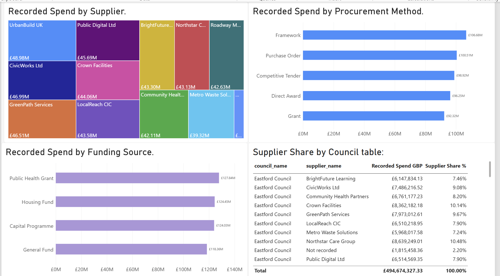

# Local Council Spending Analysis

## Project overview

I built an end-to-end analytics workflow using Python, MySQL and Power BI to analyse sample council spending data. The report helps users compare recorded spending against budget, see how spend is distributed across suppliers and understand how much has been paid or is still pending.

## Datasets and project files

| Project material | What it contains |
| --- | --- |
| [Raw data](raw/) | Sample council transactions with dates, departments, suppliers, budgets and payment statuses |
| [Processed data](processed/) | Accepted transactions, records for review and a data quality summary |
| [Rejected records](rejected/) | Transactions that failed validation |
| [Python notebook](python/local%20council.ipynb) | Data cleaning, validation and reconciliation |
| [MySQL scripts](sql/) | Table creation, controlled loading and reporting views |

## Tools and technologies

| Tool | How I used it |
| --- | --- |
| Python and pandas | Cleaned transactions, applied validation rules and reconciled row counts |
| MySQL | Staged accepted data, tracked the load and created reporting views |
| Power BI and DAX | Built a date table, defined reusable measures and designed report visuals |
| Git and GitHub | Tracked project changes and shared the analysis |

## Project phases

### Phase 1 Python data cleaning and validation

- Applied strict date validation and rejected transactions in currencies other than GBP.
- Routed negative amounts for review so they could be checked separately.
- Derived flags for recorded, paid and pending spend using payment status.
- Exported accepted, rejected and review records separately and reconciled their counts to the input.

### Phase 2 MySQL loading and analysis

I loaded the accepted transactions into a staging table, moved them into the reporting table within a transaction and verified the final row count. I used a load audit table to record the counts and completion status.

| Reporting view | Question it answers |
| --- | --- |
| Budget variance | Which councils, departments and spending categories are over or under budget? |
| Monthly spend against budget | When did recorded spend diverge from budget? |
| Supplier share by council | What proportion of each council’s recorded spend went to each supplier? |
| Payment status summary | How is spending split across payment statuses? |

### Supplier and procurement dashboard

**What the dashboard shows**

- **Procurement methods.** Frameworks had the highest recorded spend of the five methods shown at **£106.68m**, followed by purchase orders at **£100.51m**.
- **Funding sources.** Public Health Grant was the largest funding source shown at **£127.84m**, compared with **£118.36m** for the General Fund.
- **Supplier share.** Northstar Care Group accounted for **10.48%** of Eastford Council’s recorded spend in the view shown. A further **2.20%** was grouped under **Not recorded**, making missing supplier information visible.

### Phase 3 Power BI modelling and reporting

I added a date table and built DAX measures for recorded, paid and pending spend, budget variance, transaction count and supplier share. The report also includes a monthly spend trend, a council-by-department variance matrix and a payment status and data quality page.

## Metric definitions

| Metric | Definition |
| --- | --- |
| Recorded spend | Includes paid, approved, pending and under-review transactions. Excludes cancelled transactions. |
| Paid spend | Includes transactions with a paid status. |
| Pending spend | Includes approved, pending and under-review transactions. |
| Budget variance | Recorded spend minus budget. Variance percentage is blank when the budget is zero or missing. |
| Supplier share | Supplier recorded spend divided by the council’s total recorded spend within the other active report filters. |

*The figures shown are from the sample dataset used in this portfolio project.*
